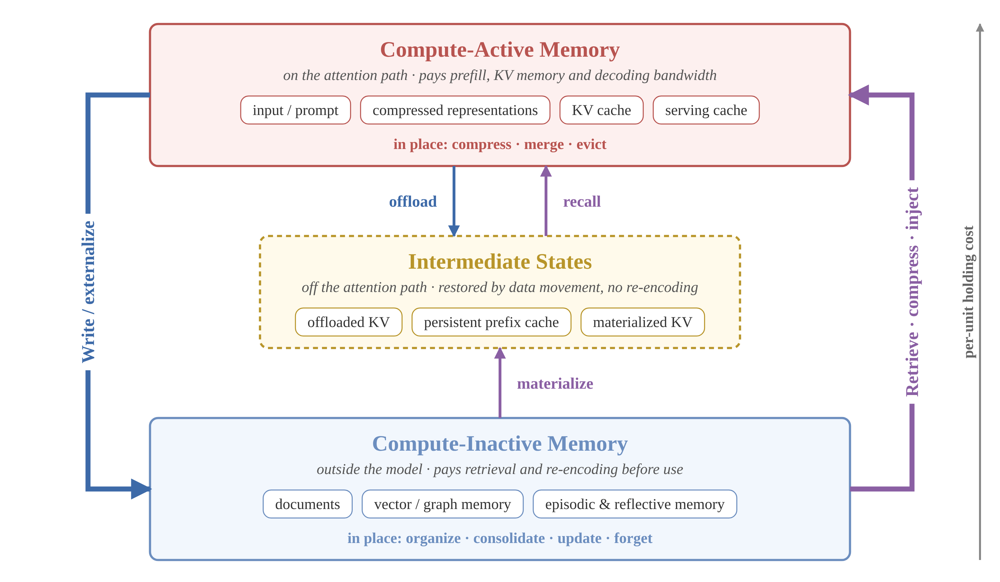
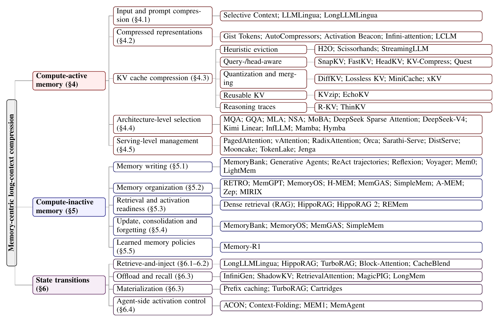

<div align="center">

# Awesome Memory-Centric Compression for LLMs

**A curated paper list for the survey**<br>
*From Long Context to Selective Memory: A Survey of Memory-Centric Compression for Large Language Models*

[](https://awesome.re)
[](#-citation)
[](#-paper-list)
[](CONTRIBUTING.md)
[](LICENSE)

</div>

## 📢 News

- **[2026-10]** Repository released together with the paper list of the survey. The preprint will be linked here once it is available on arXiv.

## 📖 Overview

Longer context windows do not remove the computational, storage, and information-selection pressures of long-context inference. This survey treats long-context compression as **memory management for inference-time computation**: the central question is which information should enter the expensive attention path, when, and in what form.

| Memory state | What it contains | Main cost |
|---|---|---|
| **Compute-active memory** | Prompt tokens, compressed representations, KV caches, serving caches | Prefill computation, KV memory, decoding bandwidth |
| **Intermediate states** | Offloaded KV caches, persistent prefix caches, materialized KV | Storage and data movement; recoverable without re-encoding |
| **Compute-inactive memory** | Documents, vector and graph memory, episodic and reflective memory | Retrieval, compression, and re-encoding before use |

Methods are organized by the state they operate on and by the **state transitions** they perform: writing, offloading, recall, retrieval-and-injection, materialization, eviction, consolidation, and forgetting.

<p align="center">
  
</p>

## 🗂️ Taxonomy

<p align="center">
  
</p>

## 📑 Table of Contents

- [Related Surveys](#related-surveys)
  - [Long-context LLMs](#long-context-llms)
  - [Prompt compression, KV cache, and efficient serving](#prompt-compression-kv-cache-and-efficient-serving)
  - [RAG and agent memory](#rag-and-agent-memory)
  - [Unified views of LLM memory](#unified-views-of-llm-memory)
- [Background: Long-Context Models and Their Limits](#background-long-context-models-and-their-limits)
  - [Long-context models and context extension](#long-context-models-and-context-extension)
  - [Failure modes of long-context use](#failure-modes-of-long-context-use)
- [Compute-Active Memory Compression](#compute-active-memory-compression)
  - [Input and prompt compression](#input-and-prompt-compression)
  - [Compressed representations](#compressed-representations)
  - [KV cache compression: heuristic eviction](#kv-cache-compression-heuristic-eviction)
  - [KV cache compression: query-, head-, and layer-aware selection](#kv-cache-compression-query--head--and-layer-aware-selection)
  - [KV cache compression: quantization, merging, and reuse](#kv-cache-compression-quantization-merging-and-reuse)
  - [KV cache compression: reasoning traces](#kv-cache-compression-reasoning-traces)
  - [Architecture-level selective computation](#architecture-level-selective-computation)
  - [Serving-level cache and prefix management](#serving-level-cache-and-prefix-management)
- [Compute-Inactive Memory](#compute-inactive-memory)
  - [Memory writing](#memory-writing)
  - [Memory organization](#memory-organization)
  - [Memory retrieval](#memory-retrieval)
  - [Learned memory-management policies](#learned-memory-management-policies)
- [State Transitions: Retrieval, Injection, and Intermediate States](#state-transitions-retrieval-injection-and-intermediate-states)
  - [Retrieve-and-inject at the KV level](#retrieve-and-inject-at-the-kv-level)
  - [Offloading and recall](#offloading-and-recall)
  - [Materialization and the parametric boundary](#materialization-and-the-parametric-boundary)
  - [Agent-side activation control](#agent-side-activation-control)
  - [Memory security](#memory-security)
- [Benchmarks and Evaluation](#benchmarks-and-evaluation)
  - [Long-context understanding and retrieval](#long-context-understanding-and-retrieval)
  - [KV-cache-centric evaluation](#kv-cache-centric-evaluation)
  - [Long-term and agent memory](#long-term-and-agent-memory)
  - [Code and agent tasks](#code-and-agent-tasks)
- [Citation](#-citation)
- [Contributing](#-contributing)

## 📚 Paper List

Papers are listed in the section of the survey where they are primarily discussed; within each group, newer papers come first. Venues follow the published version when available.

### Related Surveys

#### Long-context LLMs

| Paper | Venue | Year | Links |
|---|---|---|---|
| A Comprehensive Survey on Long Context Language Modeling | arXiv | 2025 | [[Paper]](https://arxiv.org/abs/2503.17407) |
| A Survey on Transformer Context Extension: Approaches and Evaluation | arXiv | 2025 | [[Paper]](https://arxiv.org/abs/2503.13299) |
| Thus Spake Long-Context Large Language Model | arXiv | 2025 | [[Paper]](https://arxiv.org/abs/2502.17129) [[Code]](https://github.com/OpenMOSS/Thus-Spake-Long-Context-LLM) |

#### Prompt compression, KV cache, and efficient serving

| Paper | Venue | Year | Links |
|---|---|---|---|
| KV Cache Optimization Strategies for Scalable and Efficient LLM Inference | arXiv | 2026 | [[Paper]](https://arxiv.org/abs/2603.20397) |
| Prompt Compression for Large Language Models: A Survey | NAACL | 2025 | [[Paper]](https://doi.org/10.18653/v1/2025.naacl-long.368) [[Code]](https://github.com/ZongqianLi/Prompt-Compression-Survey) |
| A Survey on Efficient Inference for Large Language Models | arXiv | 2024 | [[Paper]](https://arxiv.org/abs/2404.14294) |
| A Survey on Large Language Model Acceleration based on KV Cache Management | arXiv | 2024 | [[Paper]](https://arxiv.org/abs/2412.19442) [[Code]](https://github.com/TreeAI-Lab/Awesome-KV-Cache-Management) |
| Towards Efficient Generative Large Language Model Serving: A Survey from Algorithms to Systems | arXiv | 2023 | [[Paper]](https://arxiv.org/abs/2312.15234) |

#### RAG and agent memory

| Paper | Venue | Year | Links |
|---|---|---|---|
| Context Compression for LLM Agents: A Survey of Methods, Failure Modes, and Evaluation | EMNLP | 2026 | [[Paper]](https://www.preprints.org/manuscript/202605.2065) [[Code]](https://github.com/YerbaPage/Awesome-Agent-Context-Compression) |
| Memory for Autonomous LLM Agents: Mechanisms, Evaluation, and Emerging Frontiers | arXiv | 2026 | [[Paper]](https://arxiv.org/abs/2603.07670) |
| Memory in the Age of AI Agents: A Survey | arXiv | 2025 | [[Paper]](https://arxiv.org/abs/2512.13564) [[Code]](https://github.com/Shichun-Liu/Agent-Memory-Paper-List) |
| A Survey on the Memory Mechanism of Large Language Model based Agents | arXiv | 2024 | [[Paper]](https://arxiv.org/abs/2404.13501) |
| Contextual Compression in Retrieval-Augmented Generation for Large Language Models: A Survey | arXiv | 2024 | [[Paper]](https://arxiv.org/abs/2409.13385) |
| Retrieval-Augmented Generation for Large Language Models: A Survey | arXiv | 2023 | [[Paper]](https://arxiv.org/abs/2312.10997) |

#### Unified views of LLM memory

| Paper | Venue | Year | Links |
|---|---|---|---|
| A Survey of Context Engineering for Large Language Models | arXiv | 2025 | [[Paper]](https://arxiv.org/abs/2507.13334) [[Code]](https://github.com/Meirtz/Awesome-Context-Engineering) |
| Cognitive Memory in Large Language Models | arXiv | 2025 | [[Paper]](https://arxiv.org/abs/2504.02441) |
| From Human Memory to AI Memory: A Survey on Memory Mechanisms in the Era of LLMs | arXiv | 2025 | [[Paper]](https://arxiv.org/abs/2504.15965) |
| MemOS: A Memory OS for AI System | arXiv | 2025 | [[Paper]](https://arxiv.org/abs/2507.03724) |
| Rethinking Memory in AI: Taxonomy, Operations, Topics, and Future Directions | arXiv | 2025 | [[Paper]](https://arxiv.org/abs/2505.00675) |
| The AI Hippocampus: How Far are We From Human Memory? | TMLR | 2025 | [[Paper]](https://arxiv.org/abs/2601.09113) |

### Background: Long-Context Models and Their Limits

#### Long-context models and context extension

| Paper | Venue | Year | Links |
|---|---|---|---|
| DeepSeek-V4: Towards Highly Efficient Million-Token Context Intelligence | arXiv | 2026 | [[Paper]](https://arxiv.org/abs/2606.19348) |
| Gemini 3.1 Pro Preview | Blog | 2026 | [[Paper]](https://ai.google.dev/gemini-api/docs/models/gemini-3.1-pro-preview) |
| Introducing GPT-5.5 | Blog | 2026 | [[Paper]](https://openai.com/index/introducing-gpt-5-5/) |
| LongLoRA: Efficient Fine-tuning of Long-Context Large Language Models | ICLR | 2024 | [[Paper]](https://arxiv.org/abs/2309.12307) |
| LongRoPE: Extending LLM Context Window Beyond 2 Million Tokens | arXiv | 2024 | [[Paper]](https://arxiv.org/abs/2402.13753) |
| Extending Context Window of Large Language Models via Positional Interpolation | arXiv | 2023 | [[Paper]](https://arxiv.org/abs/2306.15595) |
| YaRN: Efficient Context Window Extension of Large Language Models | arXiv | 2023 | [[Paper]](https://arxiv.org/abs/2309.00071) |
| Big Bird: Transformers for Longer Sequences | NeurIPS | 2020 | [[Paper]](https://arxiv.org/abs/2007.14062) |
| Longformer: The Long-Document Transformer | arXiv | 2020 | [[Paper]](https://arxiv.org/abs/2004.05150) |
| Transformer-XL: Attentive Language Models beyond a Fixed-Length Context | ACL | 2019 | [[Paper]](https://doi.org/10.18653/v1/P19-1285) |

#### Failure modes of long-context use

| Paper | Venue | Year | Links |
|---|---|---|---|
| Lost in the Middle: How Language Models Use Long Contexts | TACL | 2024 | [[Paper]](https://doi.org/10.1162/tacl_a_00638) |

### Compute-Active Memory Compression

#### Input and prompt compression

| Paper | Venue | Year | Links |
|---|---|---|---|
| LongLLMLingua: Accelerating and Enhancing LLMs in Long Context Scenarios via Prompt Compression | ACL | 2024 | [[Paper]](https://aclanthology.org/2024.acl-long.91/) [[Code]](https://github.com/microsoft/LLMLingua) |
| Compressing Context to Enhance Inference Efficiency of Large Language Models | EMNLP | 2023 | [[Paper]](https://aclanthology.org/2023.emnlp-main.391/) |
| LLMLingua: Compressing Prompts for Accelerated Inference of Large Language Models | EMNLP | 2023 | [[Paper]](https://aclanthology.org/2023.emnlp-main.825/) [[Code]](https://github.com/microsoft/LLMLingua) |

#### Compressed representations

| Paper | Venue | Year | Links |
|---|---|---|---|
| End-to-End Context Compression at Scale | arXiv | 2026 | [[Paper]](https://arxiv.org/abs/2606.09659) |
| Long Context Compression with Activation Beacon | ICLR | 2025 | [[Paper]](https://openreview.net/forum?id=1eQT9OzfNQ) |
| Leave No Context Behind: Efficient Infinite Context Transformers with Infini-attention | arXiv | 2024 | [[Paper]](https://arxiv.org/abs/2404.07143) |
| Adapting Language Models to Compress Contexts | EMNLP | 2023 | [[Paper]](https://aclanthology.org/2023.emnlp-main.232/) [[Code]](https://github.com/princeton-nlp/AutoCompressors) |
| Learning to Compress Prompts with Gist Tokens | NeurIPS | 2023 | [[Paper]](https://proceedings.neurips.cc/paper_files/paper/2023/hash/3d77c6dcc7f143aa2154e7f4d5e22d68-Abstract-Conference.html) [[Code]](https://github.com/jayelm/gisting) |

#### KV cache compression: heuristic eviction

| Paper | Venue | Year | Links |
|---|---|---|---|
| Efficient Streaming Language Models with Attention Sinks | ICLR | 2024 | [[Paper]](https://arxiv.org/abs/2309.17453) [[Code]](https://github.com/mit-han-lab/streaming-llm) |
| H2O: Heavy-Hitter Oracle for Efficient Generative Inference of Large Language Models | NeurIPS | 2023 | [[Paper]](https://arxiv.org/abs/2306.14048) [[Code]](https://github.com/FMInference/H2O) |
| Scissorhands: Exploiting the Persistence of Importance Hypothesis for LLM KV Cache Compression at Test Time | NeurIPS | 2023 | [[Paper]](https://arxiv.org/abs/2305.17118) |

#### KV cache compression: query-, head-, and layer-aware selection

| Paper | Venue | Year | Links |
|---|---|---|---|
| FastKV: Decoupling of Context Reduction and KV Cache Compression for Prefill-Decoding Acceleration | ACL Findings | 2026 | [[Paper]](https://arxiv.org/abs/2502.01068) |
| Not All Heads Matter: A Head-Level KV Cache Compression Method with Integrated Retrieval and Reasoning | ICLR | 2025 | [[Paper]](https://arxiv.org/abs/2410.19258) |
| KV-Compress: Paged KV-Cache Compression with Variable Compression Rates per Attention Head | arXiv | 2024 | [[Paper]](https://arxiv.org/abs/2410.00161) |
| Quest: Query-Aware Sparsity for Efficient Long-Context LLM Inference | ICML | 2024 | [[Paper]](https://arxiv.org/abs/2406.10774) [[Code]](https://github.com/mit-han-lab/quest) |
| SnapKV: LLM Knows What You are Looking for Before Generation | NeurIPS | 2024 | [[Paper]](https://arxiv.org/abs/2404.14469) [[Code]](https://github.com/FasterDecoding/SnapKV) |

#### KV cache compression: quantization, merging, and reuse

| Paper | Venue | Year | Links |
|---|---|---|---|
| EchoKV: Efficient KV Cache Compression via Similarity-Based Reconstruction | arXiv | 2026 | [[Paper]](https://arxiv.org/abs/2603.22910) |
| Semantic Integrity Matters: Benchmarking and Preserving High-Density Reasoning in KV Cache Compression | ICML | 2026 | [[Paper]](https://arxiv.org/abs/2502.01941) |
| xKV: Cross-Layer KV-Cache Compression via Aligned Singular Vector Extraction | ICML | 2026 | [[Paper]](https://arxiv.org/abs/2503.18893) |
| DiffKV: Differentiated Memory Management for Large Language Models with Parallel KV Compaction | SOSP | 2025 | [[Paper]](https://arxiv.org/abs/2412.03131) |
| KVzip: Query-Agnostic KV Cache Compression with Context Reconstruction | NeurIPS | 2025 | [[Paper]](https://arxiv.org/abs/2505.23416) |
| Lossless KV Cache Compression to 2% | arXiv | 2024 | [[Paper]](https://arxiv.org/abs/2410.15252) |
| MiniCache: KV Cache Compression in Depth Dimension for Large Language Models | NeurIPS | 2024 | [[Paper]](https://arxiv.org/abs/2405.14366) |

#### KV cache compression: reasoning traces

| Paper | Venue | Year | Links |
|---|---|---|---|
| ThinKV: Thought-Adaptive KV Cache Compression for Efficient Reasoning Models | ICLR | 2026 | [[Paper]](https://arxiv.org/abs/2510.01290) |
| R-KV: Redundancy-aware KV Cache Compression for Reasoning Models | NeurIPS | 2025 | [[Paper]](https://arxiv.org/abs/2505.24133) [[Code]](https://github.com/Zefan-Cai/R-KV) |

#### Architecture-level selective computation

| Paper | Venue | Year | Links |
|---|---|---|---|
| DeepSeek-V3.2: Pushing the Frontier of Open Large Language Models | arXiv | 2025 | [[Paper]](https://arxiv.org/abs/2512.02556) |
| Kimi Linear: An Expressive, Efficient Attention Architecture | arXiv | 2025 | [[Paper]](https://arxiv.org/abs/2510.26692) [[Code]](https://github.com/MoonshotAI/Kimi-Linear) |
| MoBA: Mixture of Block Attention for Long-Context LLMs | arXiv | 2025 | [[Paper]](https://arxiv.org/abs/2502.13189) |
| Native Sparse Attention: Hardware-Aligned and Natively Trainable Sparse Attention | ACL | 2025 | [[Paper]](https://arxiv.org/abs/2502.11089) |
| DeepSeek-V2: A Strong, Economical, and Efficient Mixture-of-Experts Language Model | arXiv | 2024 | [[Paper]](https://arxiv.org/abs/2405.04434) |
| DeepSeek-V3 Technical Report | arXiv | 2024 | [[Paper]](https://arxiv.org/abs/2412.19437) |
| Hymba: A Hybrid-head Architecture for Small Language Models | arXiv | 2024 | [[Paper]](https://arxiv.org/abs/2411.13676) |
| InfLLM: Training-Free Long-Context Extrapolation for LLMs with an Efficient Context Memory | NeurIPS | 2024 | [[Paper]](https://arxiv.org/abs/2402.04617) [[Code]](https://github.com/thunlp/InfLLM) |
| GQA: Training Generalized Multi-Query Transformer Models from Multi-Head Checkpoints | EMNLP | 2023 | [[Paper]](https://aclanthology.org/2023.emnlp-main.298/) |
| Mamba: Linear-Time Sequence Modeling with Selective State Spaces | arXiv | 2023 | [[Paper]](https://arxiv.org/abs/2312.00752) [[Code]](https://github.com/state-spaces/mamba) |
| Fast Transformer Decoding: One Write-Head is All You Need | arXiv | 2019 | [[Paper]](https://arxiv.org/abs/1911.02150) |

#### Serving-level cache and prefix management

| Paper | Venue | Year | Links |
|---|---|---|---|
| Jenga: Effective Memory Management for Serving LLM with Heterogeneity | arXiv | 2025 | [[Paper]](https://arxiv.org/abs/2503.18292) |
| Mooncake: Trading More Storage for Less Computation—A KVCache-centric Architecture for Serving LLM Chatbot | FAST | 2025 | [[Paper]](https://www.usenix.org/conference/fast25/presentation/qin) [[Code]](https://github.com/kvcache-ai/Mooncake) |
| TokenLake: A Unified Segment-level Prefix Cache Pool for Fine-grained Elastic Long-Context LLM Serving | arXiv | 2025 | [[Paper]](https://arxiv.org/abs/2508.17219) |
| DistServe: Disaggregating Prefill and Decoding for Goodput-optimized Large Language Model Serving | arXiv | 2024 | [[Paper]](https://arxiv.org/abs/2401.09670) |
| SGLang: Efficient Execution of Structured Language Model Programs | NeurIPS | 2024 | [[Paper]](https://arxiv.org/abs/2312.07104) [[Code]](https://github.com/sgl-project/sglang) |
| Taming Throughput-Latency Tradeoff in LLM Inference with Sarathi-Serve | arXiv | 2024 | [[Paper]](https://arxiv.org/abs/2403.02310) |
| vAttention: Dynamic Memory Management for Serving LLMs without PagedAttention | arXiv | 2024 | [[Paper]](https://arxiv.org/abs/2405.04437) |
| Efficient Memory Management for Large Language Model Serving with PagedAttention | SOSP | 2023 | [[Paper]](https://doi.org/10.1145/3600006.3613165) [[Code]](https://github.com/vllm-project/vllm) |
| Orca: A Distributed Serving System for Transformer-Based Generative Models | OSDI | 2022 | [[Paper]](https://www.usenix.org/conference/osdi22/presentation/yu) |

### Compute-Inactive Memory

#### Memory writing

| Paper | Venue | Year | Links |
|---|---|---|---|
| REMem: Reasoning with Episodic Memory in Language Agent | arXiv | 2026 | [[Paper]](https://arxiv.org/abs/2602.13530) |
| LightMem: Lightweight and Efficient Memory-Augmented Generation | arXiv | 2025 | [[Paper]](https://arxiv.org/abs/2510.18866) |
| Mem0: Building Production-Ready AI Agents with Scalable Long-Term Memory | arXiv | 2025 | [[Paper]](https://arxiv.org/abs/2504.19413) [[Code]](https://github.com/mem0ai/mem0) |
| Generative Agents: Interactive Simulacra of Human Behavior | arXiv | 2023 | [[Paper]](https://arxiv.org/abs/2304.03442) [[Code]](https://github.com/joonspk-research/generative_agents) |
| MemoryBank: Enhancing Large Language Models with Long-Term Memory | arXiv | 2023 | [[Paper]](https://arxiv.org/abs/2305.10250) |
| ReAct: Synergizing Reasoning and Acting in Language Models | ICLR | 2023 | [[Paper]](https://arxiv.org/abs/2210.03629) |
| Reflexion: Language Agents with Verbal Reinforcement Learning | arXiv | 2023 | [[Paper]](https://arxiv.org/abs/2303.11366) [[Code]](https://github.com/noahshinn/reflexion) |
| Voyager: An Open-Ended Embodied Agent with Large Language Models | arXiv | 2023 | [[Paper]](https://arxiv.org/abs/2305.16291) [[Code]](https://github.com/MineDojo/Voyager) |

#### Memory organization

| Paper | Venue | Year | Links |
|---|---|---|---|
| SimpleMem: Efficient Lifelong Memory for LLM Agents | arXiv | 2026 | [[Paper]](https://arxiv.org/abs/2601.02553) |
| A-MEM: Agentic Memory for LLM Agents | NeurIPS | 2025 | [[Paper]](https://arxiv.org/abs/2502.12110) [[Code]](https://github.com/agiresearch/A-mem) |
| From RAG to Memory: Non-Parametric Continual Learning for Large Language Models | arXiv | 2025 | [[Paper]](https://arxiv.org/abs/2502.14802) [[Code]](https://github.com/OSU-NLP-Group/HippoRAG) |
| Hierarchical Memory for High-Efficiency Long-Term Reasoning in LLM Agents | arXiv | 2025 | [[Paper]](https://arxiv.org/abs/2507.22925) |
| Memory OS of AI Agent | arXiv | 2025 | [[Paper]](https://arxiv.org/abs/2506.06326) |
| MIRIX: Multi-Agent Memory System for LLM-Based Agents | arXiv | 2025 | [[Paper]](https://arxiv.org/abs/2507.07957) |
| Towards Multi-Granularity Memory Association and Selection for Long-Term Conversational Agents | arXiv | 2025 | [[Paper]](https://arxiv.org/abs/2505.19549) |
| Zep: A Temporal Knowledge Graph Architecture for Agent Memory | arXiv | 2025 | [[Paper]](https://arxiv.org/abs/2501.13956) |
| HippoRAG: Neurobiologically Inspired Long-Term Memory for Large Language Models | NeurIPS | 2024 | [[Paper]](https://arxiv.org/abs/2405.14831) [[Code]](https://github.com/OSU-NLP-Group/HippoRAG) |
| MemGPT: Towards LLMs as Operating Systems | arXiv | 2023 | [[Paper]](https://arxiv.org/abs/2310.08560) [[Code]](https://github.com/letta-ai/letta) |
| Improving Language Models by Retrieving from Trillions of Tokens | ICML | 2022 | [[Paper]](https://arxiv.org/abs/2112.04426) |

#### Memory retrieval

| Paper | Venue | Year | Links |
|---|---|---|---|
| Retrieval-Augmented Generation for Knowledge-Intensive NLP Tasks | NeurIPS | 2020 | [[Paper]](https://arxiv.org/abs/2005.11401) |

#### Learned memory-management policies

| Paper | Venue | Year | Links |
|---|---|---|---|
| Memory-R1: Enhancing Large Language Model Agents to Manage and Utilize Memories via Reinforcement Learning | arXiv | 2025 | [[Paper]](https://arxiv.org/abs/2508.19828) [[Code]](https://github.com/yansikuan/memory-r1) |

### State Transitions: Retrieval, Injection, and Intermediate States

#### Retrieve-and-inject at the KV level

| Paper | Venue | Year | Links |
|---|---|---|---|
| Block-Attention for Efficient Prefilling | ICLR | 2025 | [[Paper]](https://arxiv.org/abs/2409.15355) [[Code]](https://github.com/TemporaryLoRA/Block-Attention) |
| CacheBlend: Fast Large Language Model Serving for RAG with Cached Knowledge Fusion | EuroSys | 2025 | [[Paper]](https://arxiv.org/abs/2405.16444) [[Code]](https://github.com/YaoJiayi/CacheBlend) |
| TurboRAG: Accelerating Retrieval-Augmented Generation with Precomputed KV Caches for Chunked Text | arXiv | 2024 | [[Paper]](https://arxiv.org/abs/2410.07590) |

#### Offloading and recall

| Paper | Venue | Year | Links |
|---|---|---|---|
| MagicPIG: LSH Sampling for Efficient LLM Generation | ICLR | 2025 | [[Paper]](https://arxiv.org/abs/2410.16179) [[Code]](https://github.com/Infini-AI-Lab/MagicPIG) |
| ShadowKV: KV Cache in Shadows for High-Throughput Long-Context LLM Inference | ICML | 2025 | [[Paper]](https://arxiv.org/abs/2410.21465) [[Code]](https://github.com/ByteDance-Seed/ShadowKV) |
| InfiniGen: Efficient Generative Inference of Large Language Models with Dynamic KV Cache Management | OSDI | 2024 | [[Paper]](https://arxiv.org/abs/2406.19707) |
| RetrievalAttention: Accelerating Long-Context LLM Inference via Vector Retrieval | arXiv | 2024 | [[Paper]](https://arxiv.org/abs/2409.10516) |
| Augmenting Language Models with Long-Term Memory | NeurIPS | 2023 | [[Paper]](https://arxiv.org/abs/2306.07174) |

#### Materialization and the parametric boundary

| Paper | Venue | Year | Links |
|---|---|---|---|
| Cartridges: Lightweight and General-Purpose Long Context Representations via Self-Study | arXiv | 2025 | [[Paper]](https://arxiv.org/abs/2506.06266) [[Code]](https://github.com/HazyResearch/cartridges) |
| Titans: Learning to Memorize at Test Time | arXiv | 2025 | [[Paper]](https://arxiv.org/abs/2501.00663) |

#### Agent-side activation control

| Paper | Venue | Year | Links |
|---|---|---|---|
| ACON: Optimizing Context Compression for Long-horizon LLM Agents | arXiv | 2025 | [[Paper]](https://arxiv.org/abs/2510.00615) |
| MEM1: Learning to Synergize Memory and Reasoning for Efficient Long-Horizon Agents | arXiv | 2025 | [[Paper]](https://arxiv.org/abs/2506.15841) [[Code]](https://github.com/MIT-MI/MEM1) |
| MemAgent: Reshaping Long-Context LLM with Multi-Conv RL-based Memory Agent | arXiv | 2025 | [[Paper]](https://arxiv.org/abs/2507.02259) |
| Scaling Long-Horizon LLM Agent via Context-Folding | arXiv | 2025 | [[Paper]](https://arxiv.org/abs/2510.11967) [[Code]](https://github.com/sunnweiwei/FoldAgent) |

#### Memory security

| Paper | Venue | Year | Links |
|---|---|---|---|
| A Survey on the Security of Long-Term Memory in LLM Agents: Toward Mnemonic Sovereignty | arXiv | 2026 | [[Paper]](https://arxiv.org/abs/2604.16548) |
| AgentPoison: Red-teaming LLM Agents via Poisoning Memory or Knowledge Bases | NeurIPS | 2024 | [[Paper]](https://arxiv.org/abs/2407.12784) |

### Benchmarks and Evaluation

#### Long-context understanding and retrieval

| Paper | Venue | Year | Links |
|---|---|---|---|
| HELMET: How to Evaluate Long-Context Language Models Effectively and Thoroughly | ICLR | 2025 | [[Paper]](https://arxiv.org/abs/2410.02694) [[Code]](https://github.com/princeton-nlp/HELMET) |
| NoLiMa: Long-Context Evaluation Beyond Literal Matching | ICML | 2025 | [[Paper]](https://arxiv.org/abs/2502.05167) |
| Sequential-NIAH: A Needle-In-A-Haystack Benchmark for Extracting Sequential Needles from Long Contexts | arXiv | 2025 | [[Paper]](https://arxiv.org/abs/2504.04713) |
| BABILong: Testing the Limits of LLMs with Long Context Reasoning-in-a-Haystack | NeurIPS | 2024 | [[Paper]](https://arxiv.org/abs/2406.10149) |
| LongBench v2: Towards Deeper Understanding and Reasoning on Realistic Long-context Multitasks | arXiv | 2024 | [[Paper]](https://arxiv.org/abs/2412.15204) |
| LongBench: A Bilingual, Multitask Benchmark for Long Context Understanding | ACL | 2024 | [[Paper]](https://doi.org/10.18653/v1/2024.acl-long.172) [[Code]](https://github.com/THUDM/LongBench) |
| RULER: What's the Real Context Size of Your Long-Context Language Models? | arXiv | 2024 | [[Paper]](https://arxiv.org/abs/2404.06654) [[Code]](https://github.com/NVIDIA/RULER) |
| ∞Bench: Extending Long Context Evaluation Beyond 100K Tokens | ACL | 2024 | [[Paper]](https://arxiv.org/abs/2402.13718) [[Code]](https://github.com/OpenBMB/InfiniteBench) |

#### KV-cache-centric evaluation

| Paper | Venue | Year | Links |
|---|---|---|---|
| SCBench: A KV Cache-Centric Analysis of Long-Context Methods | ICLR | 2025 | [[Paper]](https://arxiv.org/abs/2412.10319) |

#### Long-term and agent memory

| Paper | Venue | Year | Links |
|---|---|---|---|
| Evaluating Memory in LLM Agents via Incremental Multi-Turn Interactions | ICLR | 2026 | [[Paper]](https://arxiv.org/abs/2507.05257) [[Code]](https://github.com/HUST-AI-HYZ/MemoryAgentBench) |
| STALE: Can LLM Agents Know When Their Memories Are No Longer Valid? | arXiv | 2026 | [[Paper]](https://arxiv.org/abs/2605.06527) |
| Evaluating Very Long-Term Conversational Memory of LLM Agents | arXiv | 2024 | [[Paper]](https://arxiv.org/abs/2402.17753) [[Code]](https://github.com/snap-research/locomo) |
| LongMemEval: Benchmarking Chat Assistants on Long-Term Interactive Memory | arXiv | 2024 | [[Paper]](https://arxiv.org/abs/2410.10813) [[Code]](https://github.com/xiaowu0162/LongMemEval) |

#### Code and agent tasks

| Paper | Venue | Year | Links |
|---|---|---|---|
| RepoBench: Benchmarking Repository-Level Code Auto-Completion Systems | ICLR | 2024 | [[Paper]](https://arxiv.org/abs/2306.03091) |
| SWE-bench: Can Language Models Resolve Real-World GitHub Issues? | arXiv | 2023 | [[Paper]](https://arxiv.org/abs/2310.06770) |
| WebArena: A Realistic Web Environment for Building Autonomous Agents | arXiv | 2023 | [[Paper]](https://arxiv.org/abs/2307.13854) [[Code]](https://github.com/web-arena-x/webarena) |


## 📝 Citation

If you find this survey or repository useful, please cite:

```bibtex
@article{memorycentric2026survey,
  title   = {From Long Context to Selective Memory: A Survey of Memory-Centric Compression for Large Language Models},
  author  = {Author Name and others},
  journal = {arXiv preprint},
  year    = {2026}
}
```

The complete bibliography of the survey is available in [`papers.bib`](papers.bib).

## 🤝 Contributing

Suggestions of missing papers, corrections, and discussions are welcome through issues and pull requests. Please see [CONTRIBUTING.md](CONTRIBUTING.md) for the entry format; the paper list above is generated from [`data/papers.json`](data/papers.json).

## 📄 License

This repository is released under the [MIT License](LICENSE).
